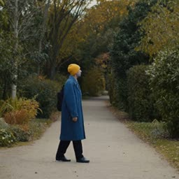
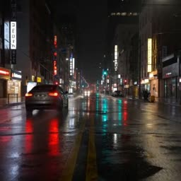

# H3 generated samples and paired evaluation

[Open local video gallery](gallery.html) · [Machine-readable manifest](manifest.json)

Each comparison uses the same prompt, seed and conditioning. Videos are separate exact-duration exports at 24 fps; original native frame alignment is retained in the generation records. Resolution, duration, sampling recipe and source identities are recorded per sample in the manifest.

BF16 is the pinned h3.c close-reference implementation, not official-pipeline or perceptual ground truth. H256 rotates only post-SwiGLU FC2 before INT8 packing; QKV, attention output and FC1 retain native INT8. Other tensors retain their original precision.

| Benchmark / seed | Mode | Preview / video |
|---|---|---|
| person-turn-v1 / 71 | BF16 |  |
| person-turn-v1 / 71 | INT8 + H256 FC2 |  |
| rainy-street-v1 / 73 | BF16 |  |
| rainy-street-v1 / 73 | INT8 + H256 FC2 |  |
| water-pour-v1 / 79 | BF16 |  |
| water-pour-v1 / 79 | INT8 + H256 FC2 |  |

## Evaluation records

All linked evaluation JSON files are copied byte-for-byte. Their checksums, sample associations, original run digests and video hashes are in the manifest. Raw latent arrays and weights are not included.

- [media: evaluations/person-turn-evaluation.json](evaluations/person-turn-evaluation.json)
- [media: evaluations/rainy-street-evaluation.json](evaluations/rainy-street-evaluation.json)
- [media: evaluations/water-pour-evaluation.json](evaluations/water-pour-evaluation.json)
- [latents: evaluations/person-turn-eval-001-benchmark-evaluation.json](evaluations/person-turn-eval-001-benchmark-evaluation.json)
- [latents: evaluations/rainy-street-eval-001-benchmark-evaluation.json](evaluations/rainy-street-eval-001-benchmark-evaluation.json)
- [latents: evaluations/water-pour-eval-001-benchmark-evaluation.json](evaluations/water-pour-eval-001-benchmark-evaluation.json)

SNR/relative L2 quantify drift from BF16; RGB SSIM is FFmpeg's planar-RGB variant. These metrics do not establish human preference, prompt adherence or motion quality. FVD/LPIPS/VBench remain explicitly unmeasured. Diagnostic capture runs are not latency samples; use the separately reported warm performance experiment.
